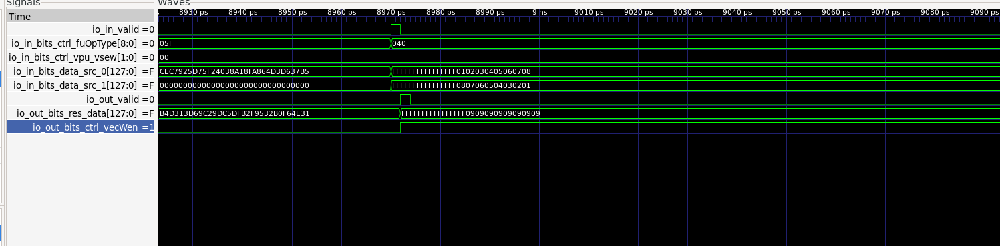

# Dense VDOT 结构探索与微基准实验结果

本文件记录 Dense VDOT 的结构比较与点积微基准。稀疏指令及标准单元评估见 [`S24.md`](S24.md)、[`S24_PPA.md`](S24_PPA.md)。

## 1. 测试平台

测试平台为香山（XiangShan）昆明湖 V2（`KunminghuV2Config`），使用 Verilator 5.048、修改后的 NEMU 参考模型及 RV64GCV 应用测试程序。RTL 与 NEMU 通过差分测试（Difftest）协同运行。

## 2. 向量加法波形验证

专用 `vadd.vv v3, v1, v2` 测试程序在 PC `0x80000168` 处执行指令编码 `0x021101d7`。测试验证了 8 个有效 INT8 元素，输出 `vadd.vv PASS: 8 lanes`；RTL–NEMU 仿真以 `HIT GOOD TRAP` 结束。

波形使用 `--dump-wave-full` 采集，保存为 `results/waveforms/vadd-full.fst`。普通 `--dump-wave` 模式仅采样一个时钟相位，不适合此次时钟边沿分析。

在 `backend/inner_vfExuBlock/exus_2/VialuFix` 中观察到：

| 信号 | 观测结果 |
|---|---|
| `io_in_valid` | 在波形时间戳约 8970 ps 时有效 |
| `io_in_bits_ctrl_fuOpType` | `0x040` |
| `io_in_bits_ctrl_vpu_vsew` | `0x00`（SEW=8） |
| `io_in_bits_data_src_0`、`src_1` | 分别包含两个由 8 个元素组成的输入序列 |
| `io_out_valid` | 在波形时间戳约 8972 ps 时有效 |
| `io_out_bits_res_data` | 低 64 位为 `0x0909090909090909` |
| `io_out_bits_ctrl_vecWen` | 随结果有效（写使能随结果传递） |

输出对应 `[1,2,3,4,5,6,7,8]` 与 `[8,7,6,5,4,3,2,1]` 的逐元素加法。上述时间戳仅表示**仿真波形采样时间**，不是物理门延迟，也不能单独证明指令在架构层面的提交时序。该波形直接展示的是功能单元计算结果。

## 3. Dense VDOT 功能验证

Dense 指令 `vdot.vv` 对 8 组有符号 INT8 数据执行乘法，并通过 Hybrid CSA 归约网络得到有符号 32-bit 点积结果。

RTL–NEMU Difftest 共 **76/76** 组通过，包括：4 组定向测试（正值、负值、最大值、最小值）、8 组数据通道映射测试，以及 64 组固定随机种子 `0x013157a6` 的随机测试。原始验证日志见 `results/validation-difftest.log`。

## 4. Dense VDOT 与标准 RVV 的点积微基准

标准 RVV 基线使用 `vle8.v`、`vwmul.vv`、`vwredsum.vs` 和 `vmv.x.s`。自定义 VDOT 路径包含两次向量加载、`vdot.vv`，并在 `SEW=32` 配置下使用 `vmv.x.s` 提取其 **32-bit** 结果。两种路径计时均包含向量配置、加载和结果提取。

三种实现均通过以下 4 组交叉正确性检查：

| 测试用例 | Scalar | RVV | VDOT |
|---|---:|---:|---:|
| 正值 | 120 | 120 | 120 |
| 负值 | -120 | -120 | -120 |
| 最大值 | 131072 | 131072 | 131072 |
| 最小值 | -130048 | -130048 | -130048 |

Benchmark 配置为每轮计时执行 1,000 次点积，共运行 5 轮；测量前预热 32 次调用，各轮轮换测量顺序，并报告各实现的最佳周期数。输入数组使用 `volatile`，禁用自动向量化。两条向量计算路径都启用了 NEMU Difftest，并以 `HIT GOOD TRAP` 结束。

| 实现 | 每 1,000 次点积总周期 | 每次点积周期 | 相对 VDOT 的周期比值 |
|---|---:|---:|---:|
| Scalar C | 24,846 | 24.846 | 2.756× |
| 标准 RVV | 13,349 | 13.349 | **1.480×** |
| 自定义 VDOT | 9,015 | 9.015 | 1.000× |

**标准 RVV 与自定义 VDOT 的点积内核加速比为 13,349 / 9,015 = 1.480×**，相当于所测周期数减少约 32.5%。这是**点积内核微基准测试**结果，不代表单条指令延迟，也不是完整 LLM 推理的 tokens/s 指标。原始日志见 `results/benchmark-rvv-difftest.log`。

## 5. 本组 Dense 微基准的测量限制

- 当前指令固定为 `SEW=8`、`LMUL=1`、`VL=8` 的无掩码点积。
- 未进行完整 LLM 推理吞吐量测试，因此不作端到端 LLM 加速声明。
- 本组 Dense 结构对比使用技术无关 Yosys Generic Cells，不能当成 ASIC 物理面积。参赛硬件另有 Nangate45 标准单元映射与 STA 结果，见 [`S24_PPA.md`](S24_PPA.md)。
- 仿真波形与功能测试通过，不能代替全面的微架构时序签核。

## 6. Dense 归约结构：Hybrid CSA 实验

从香山 `VIAluFix` 的 Chisel 实现生成五种归约结构，并在同一技术无关 Yosys 流程下进行综合（`read_slang`、`synth -flatten`、`stat`、`ltp -noff`）。Generic Cells 统计对象是**整个 `VIAluFix` 模块**，既不是 VDOT 独立电路面积，也不是 ASIC 物理面积。VDOT 逻辑深度是**拓扑门级数**，不等于实际传播延迟。

| 结构 | Generic Cells | 相对 Balanced Tree | VDOT 逻辑深度 | 独立 RTL 测试 |
|---|---:|---:|---:|---|
| Balanced Tree | 48,072 | 基线 | 47 | 已有基线验证 |
| CSA | 47,336 | −1.53% | 52 | 100,005 PASS |
| MAC Expression | 48,179 | +0.22% | 47 | 未运行 |
| **Hybrid CSA** | **47,672** | **−0.83%** | **47** | **100,005 PASS** |
| Fused Booth + CSA | 47,786 | −0.59% | 56 | 100,005 PASS |

在该组 Dense 结构实验中选择 Hybrid CSA：将 8 个乘积分为两组，每组 4 个乘积。每组经两级 3:2 CSA 压缩，再由普通加法器求和；两组结果进入最终加法器。该结构**不改变指令语义或原有单周期流水功能单元接口**。

**Dense/Hybrid 整机功能验证：** 重新生成包含 Hybrid 的完整处理器 RTL 并重新构建 Verilator 仿真器后，RTL–NEMU Difftest 全部 **76/76** 组通过，程序以 `HIT GOOD TRAP` 结束。使用实际生成 RTL 的独立测试平台完成 **100,005** 组测试。整机日志见 `results/hybrid/validation-difftest.log`。

**Dense/Hybrid 性能复测：** 在重新构建的 Hybrid 整机仿真器上运行 NEMU Difftest，五轮测量取最佳值，结果与此前的实现一致：

| 实现 | 每 1,000 次点积总周期 | 每次点积周期 |
|---|---:|---:|
| Scalar C | 24,846 | 24.846 |
| 标准 RVV | 13,349 | 13.349 |
| **Hybrid VDOT** | **9,015** | **9.015** |

标准 RVV 对比 Hybrid VDOT 的点积内核加速比仍为 **1.480×**；Scalar C 对比 Hybrid VDOT 的内核加速比为 **2.756×**。这些指标是点积内核运行周期比较，而非硬件最高时钟频率或单指令时钟周期的改善。复测日志见 `results/hybrid/benchmark-rvv-difftest.log`。
