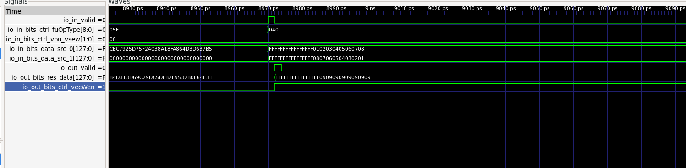

# 第一阶段——香山开发环境与 VADD 验证

## 1. 开发环境

本项目使用香山（XiangShan）昆明湖 V2 处理器及 `xs-env` 开发环境。进入开发环境的命令为：

```bash
cd ~/work/xiangshan-vdot/xs-env
nix develop
```

### 已记录的工具版本

| 组件 | 版本 | 环境说明 |
|---|---|---|
| 主机操作系统 | Ubuntu 26.04.1 LTS | 主机 |
| Nix | 2.35.1 | 主机 |
| 主机 GCC | 15.2.0 | 主机 |
| 主机 Verilator | 5.051 development（`v5.050-102-ga6f4dd031`，已修改） | 主机；并非 devshell 中的版本 |
| Nix devshell Verilator | 5.048（2026-04-26） | devshell |
| Nix devshell GCC | 15.2.0 | devshell |
| Nix devshell RISC-V Linux GCC | 15.2.0 | devshell |
| Nix devshell OpenJDK | 21.0.12 | devshell |
| Nix devshell Mill | 0.12.17 | devshell |
| Nix devshell Clang | 21.1.8 | devshell |
| `riscv64-unknown-elf-gcc` | 16.1.0（`g6afcc4f6d`） | 检查时主机和 devshell 均可使用 |
| `xs-env` 提交版本 | `8ef5238` | 检查时本地工作树的 HEAD |
| `XiangShan` 提交版本 | `0255614d4` | 检查时本地工作树的 HEAD；包含项目开发历史 |

上述 Git 提交版本记录的是**当时使用的工作环境**，不一定等同于最初的干净上游版本。参赛仓库另在 `versions.env` 中固定了上游基线提交版本。

## 2. Hello XiangShan 环境测试

测试源码路径：

```text
xs-env/nexus-am/apps/hello-jade/hello.c
```

该源码包含按要求编写的 `printf` 输出：

```text
hello xiangshan, I am Ruijue Luo, IP address: 10.172.202.240
```

这里的 IP 地址是测试程序中的**固定字符串**，不能据此认为程序自动检测了当前 IP 地址。

检查到的已有构建产物：

```text
xs-env/nexus-am/apps/hello-jade/build/hello-jade-riscv64-xs.bin
xs-env/nexus-am/apps/hello-jade/build/hello-jade-riscv64-xs.elf
xs-env/nexus-am/apps/hello-jade/build/hello-jade-riscv64-xs.txt
```

复现命令（从 `~/work/xiangshan-vdot` 执行）：

```bash
xs-env/XiangShan/build/emu \
  -i xs-env/nexus-am/apps/hello-jade/build/hello-jade-riscv64-xs.bin \
  --diff xs-env/NEMU/build/riscv64-nemu-interpreter-so \
  2>&1 | tee cie2026-jade-vdot/results/stage1/hello-xiangshan.log
```

**已核查的证据：** `results/stage1/hello-xiangshan.log` 包含 Hello XiangShan 的问候输出、`Difftest enabled` 和 `HIT GOOD TRAP`；这是已保存日志的核查结果。

## 3. VADD.VV 波形验证

独立测试程序路径：

```text
xs-env/nexus-am/apps/vadd-wave-jade/vadd_wave.c
```

反汇编得到的向量加法指令为：

```asm
80000168: 021101d7    vadd.vv v3, v1, v2
```

测试设置 `SEW=8`，执行 8 个有效向量元素的加法。输入与预期结果如下：

```text
A = [1, 2, 3, 4, 5, 6, 7, 8]
B = [8, 7, 6, 5, 4, 3, 2, 1]
Expected = [9, 9, 9, 9, 9, 9, 9, 9]
```

观察到 ALU 输出低 64 位为 `0x0909090909090909`，与预期的 8 个 8-bit 结果一致。测试同时报告 `vadd.vv PASS: 8 lanes` 和 `Core 0: HIT GOOD TRAP`，并启用了 RTL–NEMU Difftest。

为捕获完整时钟翻转，而不只是单一时钟边沿，波形使用 `--dump-wave-full` 生成：

```bash
cd ~/work/xiangshan-vdot
xs-env/XiangShan/build/emu \
  -i xs-env/nexus-am/apps/vadd-wave-jade/build/vadd-wave-jade-riscv64-xs.bin \
  --diff xs-env/NEMU/build/riscv64-nemu-interpreter-so \
  --dump-wave-full \
  --wave-path "$PWD/cie2026-jade-vdot/results/waveforms/vadd-full.fst" \
  -b 0 -e 10000 \
  2>&1 | tee cie2026-jade-vdot/results/vadd-wave-full.log
```

波形分析所使用的执行单元实例路径：

```text
TOP/SimTop/l_soc/core_with_l2/core/backend/inner_vfExuBlock/exus_2/VialuFix
```

| 信号 | 观测结果 |
|---|---|
| `io_in_valid` | 在波形时间戳约 8970 ps 时有效 |
| `io_in_bits_ctrl_vpu_vsew` | `0x00`（SEW=8） |
| `io_in_bits_ctrl_fuOpType` | 所检查指令对应 `0x040` |
| `io_in_bits_data_src_0` | 低 64 位为 `0x0102030405060708` |
| `io_in_bits_data_src_1` | 低 64 位为 `0x0807060504030201` |
| `io_out_valid` | 在波形时间戳约 8972 ps 时有效 |
| `io_out_bits_res_data` | 低 64 位为 `0x0909090909090909` |
| `io_out_bits_ctrl_vecWen` | 与结果一起有效 |

上述时间戳之差仅是**仿真波形记录中的时间间隔**，不能单独作为物理门延迟或可靠的指令延迟测量。波形用于展示向量 ALU 内有效输入和结果的顺序关系；端到端功能正确性另由向量存储/回读测试及 Difftest 通过结果佐证。

### 证据文件

- `results/waveforms/vadd_execution.png`：GTKWave 中的输入/输出波形截图。
- `results/vadd-wave-full.log`：VADD 波形仿真日志。
- `results/vadd-wave-verification.log`：VADD 功能验证日志。



## 4. 第一阶段证据核查清单

- [x] 分别记录 devshell 和主机的工具版本。
- [x] 确认 Hello XiangShan 测试源码与已构建二进制文件。
- [x] 已核查 Hello XiangShan 日志中的问候语、Difftest 和 `HIT GOOD TRAP`。
- [x] 运行并验证 8-lane VADD 功能测试与 RTL–NEMU Difftest。
- [x] 捕获并保存 VADD 执行单元波形截图。
- [ ] 如比赛提交系统要求，附上开发环境和操作过程的配音录屏。
