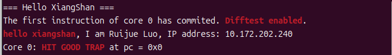
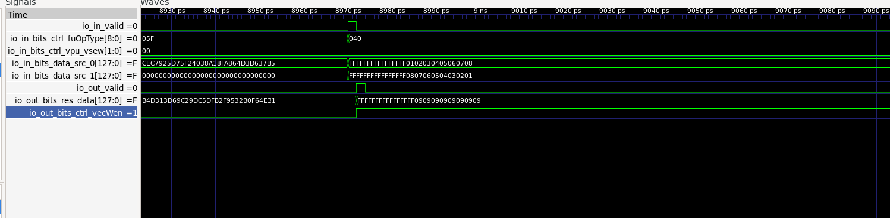

# 第一阶段：开发环境部署与 VADD 指令验证

**参赛队伍：山海核**　　**平台：XiangShan 昆明湖 V2（KunminghuV2Config）**

## 1.1 环境部署与 Hello XiangShan

本项目采用 `xs-env` 管理 XiangShan、NEMU、nexus-am 及相关子仓库，在 Nix 开发环境中构建 Verilator 仿真器和 RISC-V 测试程序。实际测试使用的 Nix 环境包括 Verilator 5.048、GCC 15.2.0、OpenJDK 21.0.12、Mill 0.12.17 和 Clang 21.1.8。完整工具版本见 [环境与 VADD 记录](STAGE1_ENVIRONMENT_AND_VADD.md)。

Hello XiangShan 程序在处理器仿真器中输出：

```text
The first instruction of core 0 has commited. Difftest enabled.
hello xiangshan, I am Ruijue Luo, IP address: 10.172.202.240
Core 0: HIT GOOD TRAP
```

IP 地址是 Hello 程序中的测试标识。仿真启用了 RTL–NEMU Difftest，并正常结束。运行日志：[hello-xiangshan.log](../results/stage1/hello-xiangshan.log)。程序源文件归档在 `source/nexus-am/apps/hello-jade/`。



## 1.2 开发环境与操作记录

开发环境通过 `xs-env` 和 Nix 统一管理，构建 XiangShan Verilator 仿真器、NEMU 参考模型及 `nexus-am` 测试程序。测试程序在 RTL–NEMU Difftest 模式下运行；VADD 同时采集执行单元全波形，用于分析操作数、控制信号和计算结果。

开发环境配置见 [工具与系统记录](../results/environment.txt)，测试过程分别记录在 [Hello XiangShan](../results/stage1/hello-xiangshan.log) 和 [VADD](../results/vadd-wave-full.log) 日志中。编译及运行命令见根目录 [README](../README.md#复现方法)。

## 1.3 VADD.VV 指令在香山中的执行过程

测试程序先设置 `SEW=e8`、`LMUL=m1`、`VL=8`，用两条 `vle8.v` 将两组 8-bit 数据送入 `v1` 和 `v2`，随后执行 `vadd.vv v3, v1, v2`，最后通过 `vse8.v` 将结果写回内存进行检查。指令编码为 `0x021101d7`，反汇编位置为 `0x80000168`。

```text
vsetivli / vle8.v    →   vadd.vv 译码   →   向量整数执行单元 VIAluFix
(SEW=e8, VL=8)          (vialuF)             输入有效、操作数和操作类型
                                                     ↓
内存中的 8 个结果  ←   vse8.v 写回      ←   执行结果与 vecWen 输出
```

波形中的执行单元路径：`TOP/SimTop/l_soc/core_with_l2/core/backend/inner_vfExuBlock/exus_2/VialuFix`。在已保存的波形中：

| 观察信号 | 观察值或行为 |
|---|---|
| `io_in_valid` | 有效输入到达执行单元 |
| `io_in_bits_ctrl_fuOpType` | `0x040` |
| `io_in_bits_ctrl_vpu_vsew` | `0x00`（e8） |
| `io_in_bits_data_src_0` | 低 64 位 `0x0102030405060708` |
| `io_in_bits_data_src_1` | 低 64 位 `0x0807060504030201` |
| `io_out_valid` | 随运算结果有效 |
| `io_out_bits_res_data` | 低 64 位 `0x0909090909090909` |
| `io_out_bits_ctrl_vecWen` | 随运算结果有效 |

输入分别代表 `[1,2,3,4,5,6,7,8]` 和 `[8,7,6,5,4,3,2,1]`，每个有效 Lane 的结果都应为 9。`vse8.v` 回读检查得到 `vadd.vv PASS: 8 lanes`，同时 Difftest 启用并以 `HIT GOOD TRAP` 正常结束。上述记录用于观察向量整数执行单元的输入、输出和控制信号。



测试程序：[vadd_wave.c](../source/nexus-am/apps/vadd-wave-jade/vadd_wave.c)；运行日志：[功能验证](../results/vadd-wave-verification.log)与[全波形模式](../results/vadd-wave-full.log)。
