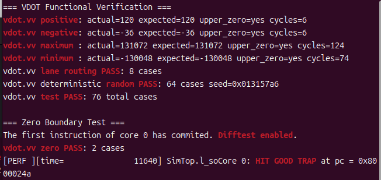

# 第二阶段：VDOT 指令设计、RTL 实现与基础功能测试

**参赛队伍：山海核**　　**平台：XiangShan 昆明湖 V2**

## 2.1 指令语义与编码

`vdot.vv` 执行 8 组有符号 INT8 乘加，返回单个有符号 32-bit 点积：

```text
vdot.vv vd, vs2, vs1
sum = Σ(i=0..7) int8(vs2[i]) × int8(vs1[i])
vd[31:0] = sum; vd[127:32] = 0
```

当前 Dense 指令采用 `funct6=111001`、`vm=1`、`funct3=000`、`opcode=1010111`，示例机器码为 `0xe61101d7`，对应 `vdot.vv v3,v1,v2`。测试配置 `SEW=e8`、`LMUL=m1`、`VL=8`；不支持带掩码执行。指令编码、译码及执行逻辑分别实现在 Rocket Chip、XiangShan 和 NEMU 中，具体设计见 [VDOT 设计](DESIGN.md)。

在同一执行单元中还实现了 2:4 结构化稀疏点积指令（`VDOT_S24_VV`，`funct6=111010`，`vm=1`）。每组 4 个权重保留 2 个非零项；输入包含 8 个激活值、8 个压缩权重和 4 组 4-bit 元数据。该操作返回两个有符号 32-bit 部分和，使用相同的八个 INT8 乘法器。稀疏指令的操作数布局及非法配置行为见 [稀疏运算设计](S24.md)。

## 2.2 微架构与数据通路

指令译码从 Rocket Chip 的 `Instructions.scala` 进入 XiangShan `VecDecoder.scala`，选中 `FuType.vialuF`，并由 Yunsuan 操作码区别 Dense VDOT 和稀疏 VDOT。执行模块为 `VIAluFix.scala`，保持现有单周期流水单元的有效信号、寄存器及写回接口。

```text
指令编码 → VecDecoder → VialuFixType → VIAluFix
                                         │
                  输入选择（Dense / 2:4 Sparse + FastSel）
                                         │
                       8 × signed INT8 乘法器
                                         │
                     19-bit CSA 分组压缩与求和
                                         │
                       流水线寄存器 / 结果选择
                                         │
                          写回结果 / 异常标志
```

FastSel 使用掩码位直接生成激活值选择信号，避免先计算二进制索引再使用动态向量选择器。两个模式共用乘法器、CSA 网络；稀疏模式的两个分组结果分别符号扩展到 32 位。对于不支持的 `SEW/LMUL`、稀疏模式 `VL/vstart` 或无效 2:4 掩码，执行逻辑产生非法指令异常。

完整 RTL 修改：[`patches/s24/xiangshan.patch`](../patches/s24/xiangshan.patch)；指令编码：[`rocket-chip.patch`](../patches/s24/rocket-chip.patch)；操作类型：[`yunsuan.patch`](../patches/s24/yunsuan.patch)。

## 2.3 正数、负数及边界值测试

测试在 XiangShan Verilator 仿真器中运行，用 C 参考点积计算期待值，读取指令写回的低 32 位并检查高 96 位清零。NEMU Difftest 同时开启。原始日志：[validation-difftest.log](../results/validation-difftest.log)。

| 测试类型 | 主要输入 | 参考结果 | RTL 结果 |
|---|---|---:|---:|
| 正数 | `[1..8]` × `[8..1]` | 120 | 120 |
| 负数 | `[-1]×8` × `[1..8]` | −36 | −36 |
| 最大值 | `[-128]×8` × `[-128]×8` | 131072 | 131072 |
| 最小值 | `[-128]×8` × `[127]×8` | −130048 | −130048 |

另有 8 组 Lane 映射测试和 64 组固定随机种子（`0x013157a6`）测试，**合计 76/76 PASS**，Difftest 启用并以 `HIT GOOD TRAP` 结束。测试源码：[vdot.c](../source/nexus-am/apps/vdot-jade/vdot.c)。

针对全零输入，独立程序 [`software/vdot-zero/`](../software/vdot-zero/) 分别测试全零左操作数和全零右操作数。**两组均通过（2/2 PASS）**；XiangShan–NEMU Difftest 已启用，仿真以 `HIT GOOD TRAP` 结束。运行日志：[zero-difftest.log](../results/stage2/zero-difftest.log)。全零测试独立于上述 76 组回归测试。



### 其他测试

Dense 归约结构的独立 RTL 回归完成 **100,005** 组测试；2:4 稀疏运算在 INT8 MLP 应用中取得 **32/32** 参考预测一致结果。详见 [结构比较](RESULTS.md) 与 [应用性能](STAGE3_REPORT.md)。
