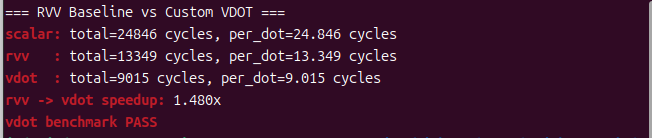
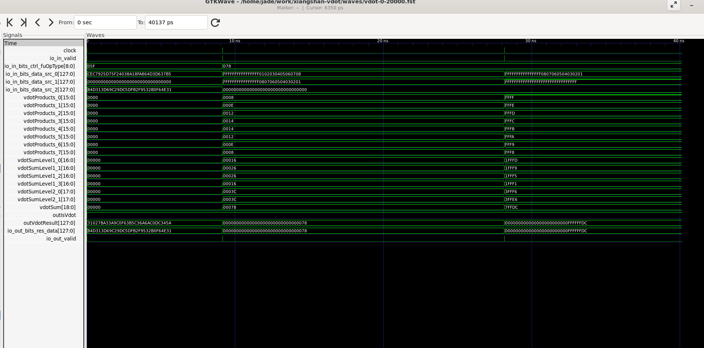
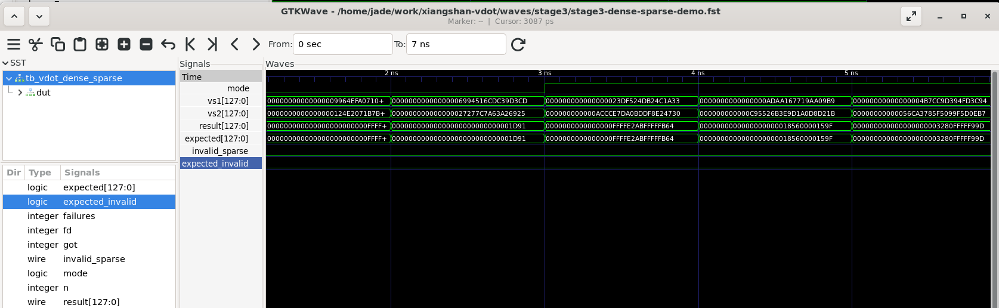

# 第三阶段：NEMU 协同仿真、RVV Baseline 与延迟加速分析

**参赛队伍：山海核**　　**平台：XiangShan 昆明湖 V2 + NEMU Difftest**

## 3.1 NEMU 指令扩展与协同仿真

在 NEMU 的 RVV 指令译码与 `vcompute.h` 中加入自定义 VDOT 处理：读取低 8 个有符号 INT8 输入，独立累加，写入目标向量低 32 位并清零高位。2:4 稀疏模式按元数据选择激活值，分别计算两个部分和；不合法的稀疏掩码与向量配置触发非法指令异常。相关改动见 [`patches/s24/nemu.patch`](../patches/s24/nemu.patch)。

硬件和 NEMU 采用独立实现：Chisel RTL 走共享乘法器与 CSA 数据通路，NEMU 使用顺序 C 算法。Difftest 比较两种独立实现的指令结果。

仿真运行结果如下：


*图 3-1：VDOT 指令差分测试，76 组测试通过。*

对应日志：[VDOT 指令 Difftest](../results/validation-difftest.log)、[Dense Hybrid 整机 Difftest](../results/hybrid/validation-difftest.log)；稀疏应用的测试记录位于 [`results/vdot-s24/real-int8-pairacc/`](../results/vdot-s24/real-int8-pairacc/)。

## 3.2 RVV Baseline 实现

Baseline 通过 RISC-V 标准向量指令实现相同的 8-lane signed INT8 点积：

```text
vle8.v         加载两个 INT8 输入向量
vwmul.vv       有符号 INT8 宽化乘法
vwredsum.vs    宽化归约求和
vmv.x.s        提取结果
```

自定义路径同样包含向量配置、数据加载与结果提取，核心计算使用 `vdot.vv`。周期统计包含向量配置、加载、计算、结果提取和循环开销。

Baseline 与自定义指令的四种输入均得到一致结果：`120`、`−120`、`131072`、`−130048`。微基准与定向测试使用不同的负数输入，结果分别为 `−120` 和 `−36`。

软件源码：[vdot_bench.c](../source/nexus-am/apps/vdot-bench-jade/vdot_bench.c)。

## 3.3 延迟加速比分析

每轮测量 1,000 次点积，先进行 32 次预热，交替安排不同实现的计时顺序；总计测量 5 轮，各取最小周期数。使用 `volatile` 输入并禁止自动向量化；RTL–NEMU Difftest 启用，测试以 `HIT GOOD TRAP` 结束。

| 实现 | 1,000 次点积总周期 | 每次点积周期 |
|---|---:|---:|
| Scalar C | 24,796 | 24.796 |
| 标准 RVV Baseline | 13,349 | 13.349 |
| **自定义 VDOT** | **9,015** | **9.015** |

**RVV → VDOT 加速比 = 13,349 / 9,015 = 1.480×**，周期降低约 **32.5%**。Scalar → VDOT 为 **2.750×**。

原始测试日志：[benchmark-rvv-difftest.log](../results/benchmark-rvv-difftest.log)、[Hybrid 复测](../results/hybrid/benchmark-rvv-difftest.log)；分析细节见 [Dense 微基准报告](RESULTS.md)。



## 3.4 稀疏计算的应用验证

工程在 Dense VDOT 之外实现了共享乘法器的 2:4 稀疏 VDOT，并用于 **64→32→10 的 INT8 MLP**，共测试 32 个样本。32/32 结果与 Python INT8 参考预测一致，31/32 分类正确，Difftest 正常结束。比较同一轮应用的两种累加方法：

| 软件策略 | 32 个样本的周期数（5 轮中位数） |
|---|---:|
| Specialized | 19,387 |
| PairAcc | **19,308** |

PairAcc 的周期降低约 **0.41%**，反映的是应用层累加策略优化。软件及日志：[PairAcc 应用](../software/VDOT_Real_INT8_PAIRACC/)与[运行摘要](../results/vdot-s24/real-int8-pairacc/summary.txt)。

## 3.5 微架构优化、标准单元面积与时序

五种 Dense 归约网络在同一技术无关综合流程下比较；在集成稀疏功能时进一步采用 FastSel 和共享 8 个乘法器。Nangate45 映射后的 `VIAluFix` 模块评估如下：

| 配置 | 标准单元数 | 面积（μm²） | 10 ns 理想时钟下最差 Setup Slack（ns） |
|---|---:|---:|---:|
| 禁用稀疏功能 | 38,136 | 48,587.028 | 1.62 |
| FastSel 优化前 | 38,789 | 49,517.496 | 2.99 |
| **FastSel** | **38,724** | **49,354.172** | **2.71** |

稀疏功能在该模块上的面积增量为 **767.144 μm²（1.579%）**；FastSel 相比优化前节省 **163.324 μm²（0.330%）**。FastSel 缩短了独立通路的拓扑逻辑级数，但在此映射 STA 中并**未**改善整个模块最差 Setup Slack。以上为布局布线前的标准单元映射结果。完整记录见 [面积与时序报告](S24_PPA.md)。

## 3.6 可扩展性与实现边界

计算结构中的乘积生成、CSA 归约及元数据选择可进一步参数化；现有硬件支持固定的 8-lane INT8 Dense VDOT，以及规定的 2:4 稀疏格式；没有实现通用 SEW/VLEN/LMUL 或自动掩码执行。增加向量宽度需扩展乘法器数量或引入多周期累加；支持更宽 SEW 需调整乘积位宽、归约树和溢出处理；支持通用 VL/vstart 需要额外控制逻辑。

## 3.7 RTL 波形验证：算术数据通路与稠密/稀疏模式切换

### 3.7.1 八路有符号乘法与归约树

VDOT 算术数据通路使用八路有符号 INT8 乘法，产生 `vdotProducts_0` 至 `vdotProducts_7`，随后通过 `vdotSumLevel1`、`vdotSumLevel2` 和 `vdotSum` 逐层求和。波形中的示例输出包括正数点积 **120** 和负数点积 **−36**，对应的输出结果与归约结果一致。



*图 3-2：VDOT 八路乘法、分层归约与正负数结果。*

### 3.7.2 稠密/稀疏模式切换及有符号计算

对独立 Dense/Sparse VDOT RTL 模块进行 Verilator 功能仿真，测试平台将 `result` 与参考结果 `expected` 比较，并检查 `invalid_sparse` 与 `expected_invalid` 是否一致。全部 **6,010 组测试向量通过**：

```text
PASS: RTL 6010 vectors
SIM_EXIT_CODE=0
```

为清楚展示模式切换，从已通过的测试向量中选取相邻的七组用于波形观察。`mode=0` 为稠密模式，`mode=1` 为 2:4 稀疏模式。约 **3 ns** 时由稠密切换到稀疏模式，计算结果如下：

| 时间区间 | 模式 | 计算结果（十六进制） | 结果含义 |
|---|---|---|---|
| 2–3 ns | 稠密（0） | `0x00001D91` | 单个正数点积 |
| 3–4 ns | 稀疏（1） | `0xFFFFE2ABFFFFFB64` | 两个负数部分和 |
| 4–5 ns | 稀疏（1） | `0x000018560000159F` | 两个正数部分和 |
| 5–6 ns | 稀疏（1） | `0x00003280FFFFF99D` | 一正一负两个部分和 |

上述样例中，`result` 与 `expected` 一致，稀疏掩码的非法标志与预期一致。



*图 3-3：稠密/稀疏模式切换、两个有符号结果及参考结果比对。*

独立 RTL 仿真用于验证 Dense/Sparse 算术功能，处理器级正确性通过 XiangShan 与 NEMU 的差分测试进行验证。
